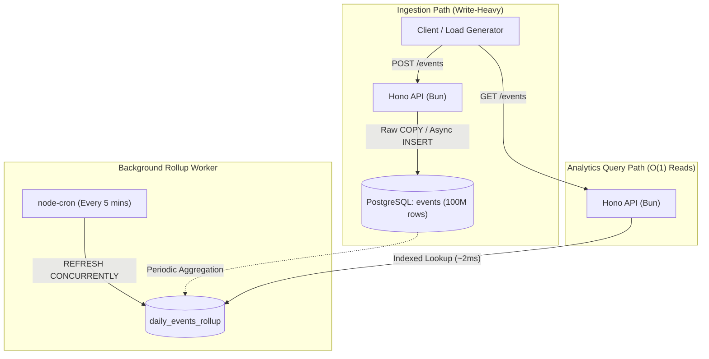

# 100M Row Challenge: Enterprise Analytics API

[](https://bun.sh/)
[](https://hono.dev/)
[](https://www.postgresql.org/)
[](https://orm.drizzle.team/)
[](https://zod.dev/)

An enterprise-grade Product Analytics API engineered to ingest, store, and query 100 million events with sub-millisecond latency. Built on Bun and PostgreSQL, this project demonstrates database indexing, background concurrency, and load resilience.

## Architecture & Tech Stack

- **Runtime:** [Bun](https://bun.sh/)
- **Framework:** [Hono](https://hono.dev/)
- **Database:** PostgreSQL 16 (Dockerized)
- **ORM:** Drizzle ORM
- **Validation:** Zod
- **Design Pattern:** Clean Architecture

### System Data Flow

The architecture separates write-heavy event ingestion from sub-millisecond query aggregation. Ingestion writes directly to raw storage, while queries read pre-computed rollups updated by a background worker.



## Performance Milestones

All benchmarks were recorded locally on a standard consumer laptop to demonstrate hardware efficiency. The system relies entirely on local compute and storage without cloud-grade database provisioning.

| Component   | Specification                                              |
| :---------- | :--------------------------------------------------------- |
| **Machine** | Lenovo ThinkPad L14 Gen 1                                  |
| **OS**      | Ubuntu Linux (KDE Plasma)                                  |
| **CPU**     | Intel(R) Core(TM) i5-10310U (4 Cores, 8 Threads @ 1.70GHz) |
| **RAM**     | 16 GB DDR4                                                 |
| **Storage** | Local NVMe SSD                                             |

### 1. B-Tree Indexing (`O(log n)`)

A B-Tree index paired with `VACUUM ANALYZE` isolates 16.6 million records out of 100 million in roughly 450ms. This confirms predictable logarithmic scaling on local hardware without full table scans.

| Dataset Size  | Optimization                  | Average Time | p95 Time      |
| :------------ | :---------------------------- | :----------- | :------------ |
| **20M Rows**  | B-Tree Index + Visibility Map | 414.33 ms    | 502.09 ms     |
| **100M Rows** | B-Tree Index + Visibility Map | 453.53 ms    | **524.57 ms** |

### 2. Materialized Views (`O(1)`)

A materialized view pre-aggregates event counts by project, event name, and day with a unique composite index. This shifts compute overhead from read-time to write-time, reducing read latency to ~2ms.

| Dataset Size  | Optimization                       | Average Time | p95 Time    |
| :------------ | :--------------------------------- | :----------- | :---------- |
| **100M Rows** | Materialized View (Pre-Aggregated) | 2.13 ms      | **3.67 ms** |

## Core Mechanics

### Streaming Data Generation (`generate-csv.ts`)

The generator streams 100 million rows to disk using stream backpressure to avoid memory crashes. It cycles through pre-allocated arrays with modulo arithmetic to generate high-cardinality test data in minutes.

### Safe Chunk Deletions (`delete-chunk.ts`)

Batch deletions target rows by internal PostgreSQL `ctid` in chunks of 10,000 to prevent table locks. Pauses between batches keep the database responsive, followed by a vacuum to reclaim storage.

### Background View Refresh (`view-refresh.ts`)

A background cron worker executes `REFRESH MATERIALIZED VIEW CONCURRENTLY` every five minutes without table locks. The unique index ensures active dashboard reads and writes remain completely unblocked during the rebuild.

### Load Testing (`load-test.ts`)

A test suite bombards the API with 50 concurrent workers running an 80/20 mix of writes and reads. The service cruises at over 1,000 RPS while handling background cron contention on local hardware.

## Getting Started

### 1. Infrastructure Setup

Install project dependencies across the monorepo using Bun. Launch the local PostgreSQL container with Docker Compose.

```bash
bun install
docker-compose up -d
```

### 2. Generate & Ingest 100M Rows

Stream 100 million rows to an 8GB CSV file on disk. Ingest the dataset directly into PostgreSQL using the high-speed binary `\copy` protocol.

```bash
# Generate the 8GB CSV (~3-5 mins)
bun --filter api run scripts/generate-csv.ts

# Ingest into PostgreSQL via raw COPY
cat data-100m.csv | docker exec -i 100m_postgres psql -U postgres -d events_db -c "\copy events(project_id, event_name, user_id, payload, created_at) FROM STDIN WITH (FORMAT csv, HEADER true);"
```

### 3. Rebuild Views & Run the API

Update PostgreSQL's visibility map and build the pre-aggregated materialized view. Start the Hono server with hot-reloading and background workers.

```bash
# Rebuild Visibility Map & Materialized View
docker exec -i 100m_postgres psql -U postgres -d events_db -c "VACUUM (ANALYZE, VERBOSE) events;"
bun --filter api run scripts/build-mat-view.ts

# Start Hono API server
bun --filter api run dev
```

## API Endpoints

- **`POST /api/v1/analytics/events`**: Validates payloads with Zod and asynchronously inserts events without blocking HTTP responses. Clients receive an immediate confirmation while persistence happens in the background.
- **`GET /api/v1/analytics/events`**: Reads aggregated metrics directly from the pre-computed materialized view. Responses return in 2-3 milliseconds with query timing metadata included.

## Production Considerations

- **Message Queues:** High-volume ingestion should buffer incoming traffic through Kafka or Redis Streams. Micro-batching writes to the database protects connection pools from exhaustion under burst load.
- **Read Consistency:** The materialized view provides eventual consistency with a five-minute data delay. A hybrid query can combine historical rollups with raw indexed scans for the current day.
- **Table Partitioning:** The single events table can be partitioned by date ranges using native PostgreSQL declarative partitioning. This allows instant data retention cleanup by dropping old partitions instead of running row-level deletes.
